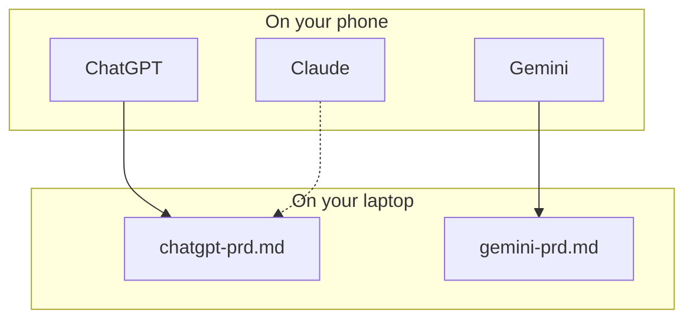
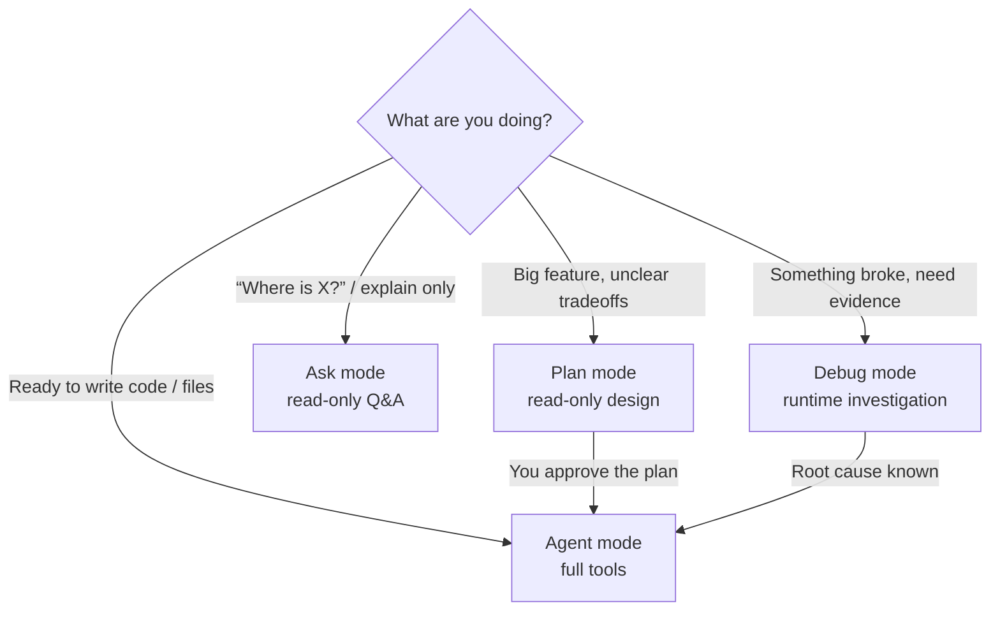
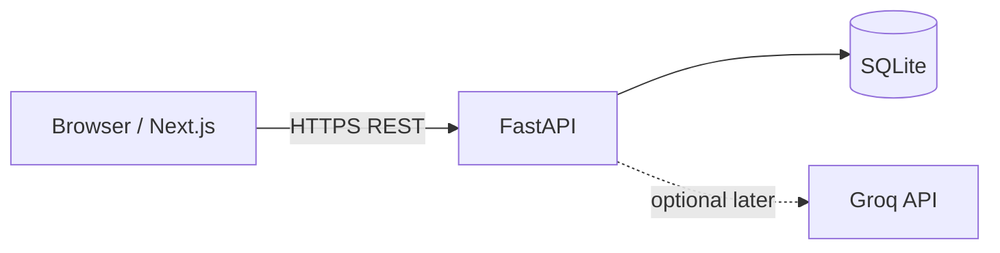
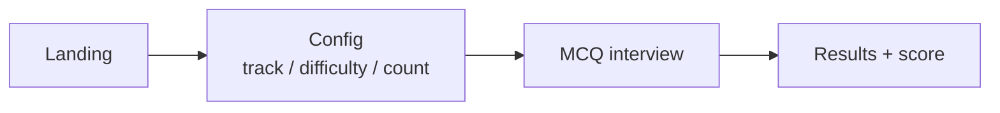
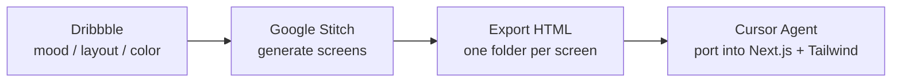
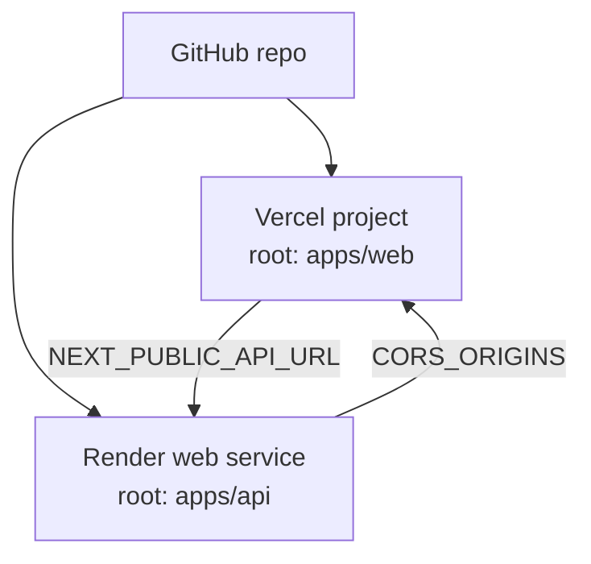
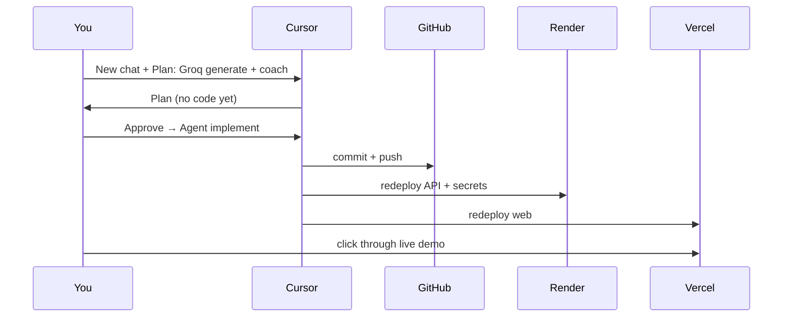
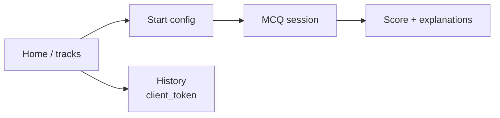

# Build & Deploy an App with Cursor — Student Follow-Along Guide

**What this is:** The exact workflow we used in the live class to ship **PrepPulse** (AI interview practice): research → PRD → code → UI → GitHub → Vercel + Render → AI features.

**Repo you can peek at:** this monorepo (`octmornint`) — Next.js on Vercel, FastAPI on Render, Groq for question generation + coaching.

**Time shape:** Research on phone before class → ~2 hours of build + deploy in Cursor → optional second chat for AI features.

---

## The map (read this once, then dive)

```mermaid
flowchart LR
  A[Phone research<br/>ChatGPT / Gemini / Claude] --> B[Paste into .md<br/>in Cursor folder]
  B --> C[Plan mode<br/>PRD + TDD]
  C --> D[Agent mode<br/>MVP scaffold]
  D --> E[Dribbble + Stitch<br/>UI design]
  E --> F[New chat<br/>Port UI + APIs]
  F --> G[GitHub repo]
  G --> H[Vercel + Render<br/>plugins → deploy]
  H --> I[Test live URLs]
  I --> J[New chat<br/>major feature e.g. Groq]
```



If you remember only one sentence: **research outside Cursor → write a PRD Cursor can follow → build in small chats → design in Stitch → deploy with plugins → open a new chat for the next big piece.**

---

## Before you open Cursor

### 0. Accounts you’ll need

| Account | Why |
| --- | --- |
| [Cursor](https://cursor.com) | Where you build |
| [GitHub](https://github.com) | Source of truth for deploys |
| [Vercel](https://vercel.com) | Hosts the Next.js frontend (Hobby / free) |
| [Render](https://render.com) | Hosts the FastAPI backend (free web service) |
| [Groq](https://console.groq.com) | Free LLM API for generation / coaching (optional for bank-only MVP) |
| [Google Stitch](https://stitch.withgoogle.com) | AI UI screens → HTML you give Cursor |
| [Dribbble](https://dribbble.com) | Visual inspiration before / while designing |

Sign up for Vercel and Render with the **same GitHub** account you’ll use for the repo. That makes “Import project” and Blueprint deploys boring (in a good way).

### Tip: use your phone for research

Sit with ChatGPT, Gemini, or Claude **on mobile**. Talk to it. Don’t type a novel on a laptop yet.

Ask things like:

- “I’m building an interview practice app for a 2-hour class. What’s a realistic MVP?”
- “Compare recruiter screening vs self-serve MCQ practice for students.”
- “What free hosting fits Next.js + FastAPI?”

When you’re done, copy the useful bits into a markdown file (or email it to yourself). You’re about to drop that file into Cursor.

---

## Step 1 — Research → markdown files

Create a project folder on your machine (example: `Documents/my-app`).

Save research as plain files Cursor can `@`-mention:

| File | Source | Job |
| --- | --- | --- |
| `chatgpt-prd.md` | ChatGPT | Market notes, competitor ideas, long wish lists |
| `gemini-prd.md` | Gemini | Second opinion, architecture guesses |
| (optional) Claude notes | Claude | Third pass / critique |

**In our class:** those files lived at the repo root. They talked about recruiter portals, voice, coding IDEs — lots of Phase-2 fantasy. That’s fine. Research is allowed to be bigger than the MVP.



---

## Step 2 — Open the folder in Cursor & give it the files

1. Cursor → **Open Folder** → your project folder.
2. Start a **new chat** (don’t dump this into an old unrelated thread).
3. Attach the research: `@chatgpt-prd.md` `@gemini-prd.md`.
4. Prefer **voice chat** in Cursor to explain what you actually want — speaking is faster than typing product nuance.

### Example voice / typed prompt

> We did research in ChatGPT and Gemini — those files are attached. For today’s class we need a **minimum viable product** we can build in ~2 hours. Write a **PRD** and a **technical design document** we can follow. Scope down aggressively. Stack: Next.js on Vercel free, FastAPI on Render free.

Then either:

- Switch to **Plan mode** and let Cursor propose the PRD/TDD structure, or  
- Stay in **Agent mode** and say “write `prd.md` and `tdd.md` now.”

**In our class:** we locked the product to **MCQ interview practice** (tracks → difficulty → count → score), bank-first, Groq later — even though research pushed JD+resume chat. The PRD **overrides** the research files. Keep research for Phase 2 ideas.

Artifacts after this step:

- `prd.md` — what we’re building  
- `tdd.md` — how (stack, APIs, data model, deploy)

---

## Step 3 — Know your Cursor modes (use the right one)



| Mode | Use it when | Don’t use it when |
| --- | --- | --- |
| **Plan** | PRD/TDD, monorepo scaffold, major features, “how should we…?” | Tiny one-line fixes |
| **Agent** | Implementing an approved plan, scaffolding, deploys | You still don’t know the product shape |
| **Ask** | Exploring code, learning “what does this file do?” | You need files created or fixed |
| **Debug** | Deploy failed, 500s, wrong scores — you want evidence | Greenfield feature design |

### Class rule: Plan mode for every major feature

Examples that deserved Plan first:

1. Monorepo MVP scaffold  
2. PrepPulse UI redesign + history APIs  
3. Groq question generation + coach feedback  

Say: *“Switch to Plan mode. Propose the smallest plan. Wait for my approval before coding.”*

### Class rule: new chat for a big thing

Don’t keep stacking “also add AI” and “also redesign UI” into the same 3-hour thread. Context gets muddy. Cursor starts “helpfully” rewriting old decisions.

| Chat | Topic |
| --- | --- |
| Chat 1 | Research → PRD + TDD → MVP scaffold |
| Chat 2 | Stitch UI → PrepPulse + history |
| Chat 3 | Deploy (Vercel + Render plugins) |
| Chat 4 | Groq AI generation + coach |

---

## Step 4 — Build the MVP (bank-first)

With `prd.md` + `tdd.md` approved, open Plan (or Agent with a clear plan) and ask for a **monorepo scaffold**.

Target shape we used:

```text
octmornint/
├── apps/
│   ├── web/          # Next.js → Vercel
│   └── api/          # FastAPI → Render
├── prd.md
├── tdd.md
├── render.yaml
└── README.md
```



**MVP user path (must work with zero LLM calls):**



Checklist before you celebrate:

- [ ] `GET /api/v1/health` works locally  
- [ ] Catalog returns tracks  
- [ ] Create session → answer → submit → score  
- [ ] Correct answers **not** leaked before submit  
- [ ] `.env` files are gitignored  

Local smoke (from our README):

```bash
# API
cd apps/api
python3 -m venv .venv && source .venv/bin/activate
pip install -r requirements.txt
uvicorn app.main:app --reload --host 0.0.0.0 --port 8000

# Web
cd apps/web
npm install
# set NEXT_PUBLIC_API_URL=http://localhost:8000 in .env.local
npm run dev
```

---

## Step 5 — Design: Dribbble inspiration → Google Stitch → Cursor

This is the part that makes the class app look like a product instead of a tutorial.



### 5a. Dribbble — steal the *feeling*, not the pixels

Search Dribbble for: *interview platform*, *quiz dashboard*, *learning app dark UI*, *MCQ test*.

Save 3–5 shots that share a vibe (sidebar + accent color + calm typography). Tell Stitch / Cursor:

> Inspiration: dark sidebar, bright accent CTA, pastel track cards, monospace for scores. Not a purple SaaS clone.

You’re feeding **direction**, not Figma-perfect clones.

### 5b. Google Stitch — generate the screens

1. Go to [stitch.withgoogle.com](https://stitch.withgoogle.com).  
2. Create a project (we branded **PrepPulse**).  
3. Prompt per screen: landing/dashboard, interview configurator, MCQ session, results / AI review.  
4. Iterate until layout feels right.  
5. Download / export — typically a folder per screen with `code.html`, plus a design-system markdown if available.

**Our export lived at:** `stitch_ai_tech_interview_platform/` with folders like:

- `home_dashboard/code.html`  
- `interview_configurator/code.html`  
- `mcq_interview_session/code.html`  
- `results_ai_review/code.html`  
- `preppulse_design_system.md`  

### 5c. New Cursor chat — port Stitch into the real app

Attach the Stitch folder (or `@` key files) and say something like:

> Port this Stitch design into `apps/web`. Keep existing API contracts. Brand: PrepPulse. Follow `preppulse_design_system.md`. Wire History if the design shows it — add backend APIs if needed.

**In our class we also:**

- Used Plan mode for “PrepPulse frontend redesign”  
- Added anonymous `client_token` + `X-Client-Token` so History works without signup  
- Left AI generation toggle as UI chrome until a later chat  

---

## Step 6 — GitHub: create the repo and connect Cursor

1. Create an empty GitHub repo (e.g. `yourname/octmornint`).  
2. In Cursor / terminal (from project root):

```bash
git init   # if needed
git add .
git commit -m "Scaffold interview practice monorepo for free-tier deploy."
git remote add origin https://github.com/<you>/<repo>.git
git push -u origin main
```

3. Confirm `.env`, `.venv`, `*.db` are **not** committed (check `.gitignore`).

Cursor can do the commit/push for you if you ask — still **never** commit secrets.

---

## Step 7 — Connect Vercel + Render plugins in Cursor

### Sign up & link accounts

1. Sign up on [Vercel](https://vercel.com) and [Render](https://render.com) with GitHub.  
2. In Cursor: open **Settings → Plugins / MCP** (wording may vary by Cursor version).  
3. Enable / authenticate the **Vercel** and **Render** plugins so Agent can create services and set env vars.  
4. Confirm the plugin can see your team / workspace.



### Why not both on Vercel free?

Long-running FastAPI + SQLite file DB is a poor fit for serverless-only free frontend hosting. **Split:** Vercel = UI, Render = API. That’s what we shipped.

### Deploy with Agent (new chat is fine)

Prompt sketch:

> Deploy frontend to Vercel and backend to Render using the plugins. Use `render.yaml`. Root Directory for Vercel = `apps/web`. Set `NEXT_PUBLIC_API_URL` to the Render URL. Set `CORS_ORIGINS` on Render to the Vercel URL. Pin Python 3.12.x. Do not put `GROQ_API_KEY` in the frontend.

**Env cheat sheet:**

| Where | Variable | Notes |
| --- | --- | --- |
| Render | `DATABASE_URL` | `sqlite:///./data/app.db` |
| Render | `SEED_ON_BOOT` | `true` — re-seed bank after cold start |
| Render | `CORS_ORIGINS` | your Vercel URL(s) + localhost if needed |
| Render | `GROQ_API_KEY` / `GROQ_MODEL` | **server only** |
| Render | `PYTHON_VERSION` | pin e.g. `3.12.8` (default 3.14 broke our build once) |
| Vercel | `NEXT_PUBLIC_API_URL` | `https://<service>.onrender.com` |

Render must bind `0.0.0.0:$PORT` (see `render.yaml` start command).

### After deploy — test like a student demo

1. Hit `https://<api>/api/v1/health` (wakes free tier).  
2. Open the Vercel URL.  
3. Start interview → finish → see score.  
4. If CORS errors: fix `CORS_ORIGINS`, redeploy API.  
5. If UI can’t reach API: check `NEXT_PUBLIC_API_URL` (no trailing slash surprises).

**Free-tier gotchas we hit:**

| Gotcha | What to do |
| --- | --- |
| Render spins down ~15 min idle | Ping `/api/v1/health` before going live in class |
| SQLite is ephemeral | History vanishes on cold start; bank re-seeds |
| Secrets in chat | Put keys in Render dashboard / plugin env — **rotate** if you ever pasted a key in chat |

---

## Step 8 — Major feature = new chat + Plan mode (example: Groq AI)

Once MVP + UI + deploy work, don’t bolt AI into the same thread.

1. **New chat**  
2. **Plan mode** — generation + coach feedback; scoring stays deterministic  
3. Approve plan → **Agent** implements  
4. Commit → push → redeploy via plugins  
5. Smoke-test bank mode and Groq mode on production  



---

## Voice chat habits (steal these)

- Explain the **product** by talking; paste **URLs / error text** when something breaks.  
- Say the constraints out loud: “2 hours”, “free tier only”, “MCQ only”, “no auth”.  
- After Plan: “Implement the plan. Don’t expand scope.”  
- For UI: “Follow the Stitch HTML; don’t invent a new design system.”  
- For deploy: “Use the Vercel and Render plugins; show me the live URLs when done.”

---

## End-to-end checklist (print / pin)

- [ ] Phone research (ChatGPT / Gemini / Claude) → `.md` files in folder  
- [ ] Cursor folder open; `@` research files  
- [ ] Voice-explain MVP; Plan or Agent writes `prd.md` + `tdd.md`  
- [ ] Plan → Agent: monorepo MVP (bank MCQs work offline from LLM)  
- [ ] Dribbble moodboard → Stitch screens → export HTML  
- [ ] **New chat**: port Stitch UI; wire APIs  
- [ ] GitHub repo + push (no secrets)  
- [ ] Vercel + Render accounts + Cursor plugins authenticated  
- [ ] Deploy web + API; CORS + `NEXT_PUBLIC_API_URL` set  
- [ ] Live test; wake Render health before demos  
- [ ] **New chat** + Plan for next big feature (e.g. Groq)  
- [ ] Redeploy and retest  

---

## What we actually shipped (so you can map theory → repo)

| Piece | Where |
| --- | --- |
| Product contract | `prd.md` |
| Architecture | `tdd.md` |
| Research (don’t treat as build truth) | `chatgpt-prd.md`, `gemini-prd.md` |
| API | `apps/api` |
| Web (PrepPulse) | `apps/web` |
| Render blueprint | `render.yaml` |
| Local + deploy notes | `README.md` |

User journey in the finished MVP:



---

## When you’re stuck

| Symptom | Mode / move |
| --- | --- |
| “Should we use Postgres or SQLite?” | Plan mode — decide once, write it into TDD |
| Build fails on Render Python | Ask Agent to pin `PYTHON_VERSION`; read build logs |
| UI looks nothing like Stitch | New chat; attach `code.html` + design system; “match this” |
| Agent keeps rewriting old features | New chat; `@prd.md` `@tdd.md` only |
| Demo cold | Hit health endpoint first |

You’ve got the loop. Research loud on the phone, write a PRD Cursor can obey, design in Stitch with a Dribbble eye, deploy with plugins, and open a fresh chat when the next feature is actually a new story.
)